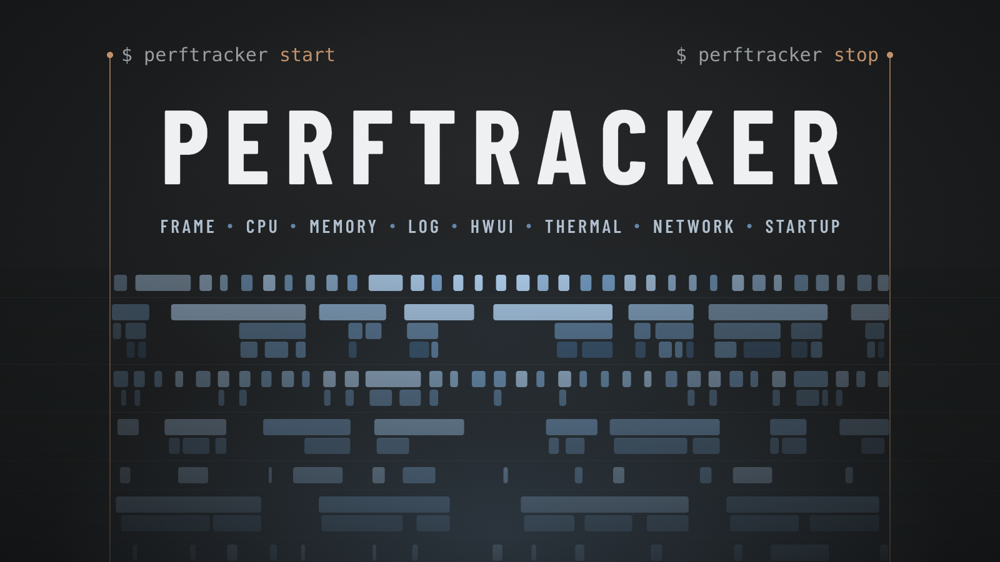

# PerfTracker



안드로이드 앱의 프레임 · CPU · 메모리 같은 성능 지표를 측정하는 CLI 입니다.
앱을 수정하거나 기기를 루팅하지 않고, adb 연결만으로 측정합니다.

## 요구 사항

- Node 20.19 이상
- adb (Android Platform Tools)
- Android 11 이상 기기

## 설치

```bash
npm i -g perftracker
```

설치 없이 `npx perftracker <명령>` 으로 써도 됩니다.

## 사용법

```bash
perftracker doctor                                  # 측정 가능한 지표 확인
perftracker start --app YouTube --name "홈 스크롤" --launch
# 폰에서 앱 조작
perftracker stop --report                           # 측정 종료 · 보고서 열기
```

결과는 `runs/<세션>/` 에 `result.json` 과 원본 트레이스로 저장됩니다. 보고서는 `perftracker report <id>` 로 다시 만들 수 있습니다.

## 지표 8개

| 지표 | 내용 |
| --- | --- |
| [`startup`](docs/result-json.md#metricsstartup) | 앱 콜드 스타트 시간 (`--launch` 일 때) |
| [`cpu`](docs/result-json.md#metricscpu) | 앱 · 기기 CPU 사용량 |
| [`memory`](docs/result-json.md#metricsmemory) | 앱 · 기기 메모리 |
| [`log`](docs/result-json.md#metricslog) | 로그 개수, 크래시 · ANR |
| [`thermal`](docs/result-json.md#metricsthermal) | 측정 전후 기기 온도 |
| [`network`](docs/result-json.md#metricsnetwork) | 측정 중 송수신 바이트 (Android 14 이상) |
| [`hwui`](docs/result-json.md#metricshwui) | 프레임 수 · 느린 프레임 · 원인별 횟수 |
| [`frame`](docs/result-json.md#metricsframe) | 프레임 시간 흐름 (Android 12 이상) |

## 명령

| 명령 | 설명 |
| --- | --- |
| `perftracker doctor` | 환경과 기기 점검 |
| `perftracker devices` | 연결된 기기 목록 |
| `perftracker apps` | 측정할 수 있는 앱 목록 |
| `perftracker start` | 측정 시작 |
| `perftracker mark <라벨>` | 측정 중 시점 기록 |
| `perftracker status` | 진행 중인 측정 확인 |
| `perftracker stop` | 측정 종료, `result.json` 생성 |
| `perftracker extract <run-dir>` | 저장된 원본으로 `result.json` 다시 생성 |
| `perftracker runs list` · `perftracker runs rename <id> <이름>` · `perftracker runs rm <id>` | 기록 목록 · 이름 변경 · 삭제 |
| `perftracker report <id>` | 기록을 HTML 보고서로 저장 |
| `perftracker open` | 브라우저 화면 실행 |
| `perftracker schema` | `result.json` 스키마 출력 |

`start` 옵션

| 옵션 | 설명 |
| --- | --- |
| `--app <이름\|패키지>` | 측정할 앱. 생략하면 현재 화면의 앱 |
| `--name <이름>` | 세션 이름 |
| `--launch` | 앱을 새로 실행하고 시작 시간 측정 |
| `--device <serial>` | 기기가 여러 대일 때 지정 |
| `--out <dir>` | 결과 저장 위치 (기본 `runs`) |
| `--force` | 남아 있는 이전 세션을 정리하고 시작 |
| `--diagnose` | 앱이 실행한 작업 이름(atrace slice)까지 기록 |
| `--compile reset\|speed-profile\|speed` | 측정 전에 앱 컴파일 상태 변경 (`--launch` 와 함께) |

## 문서

- [자세한 사용법](docs/usage.md)
- [`result.json` 필드 설명](docs/result-json.md)
- [변경 기록](CHANGELOG.md)

## 라이선스

[MIT](LICENSE)
