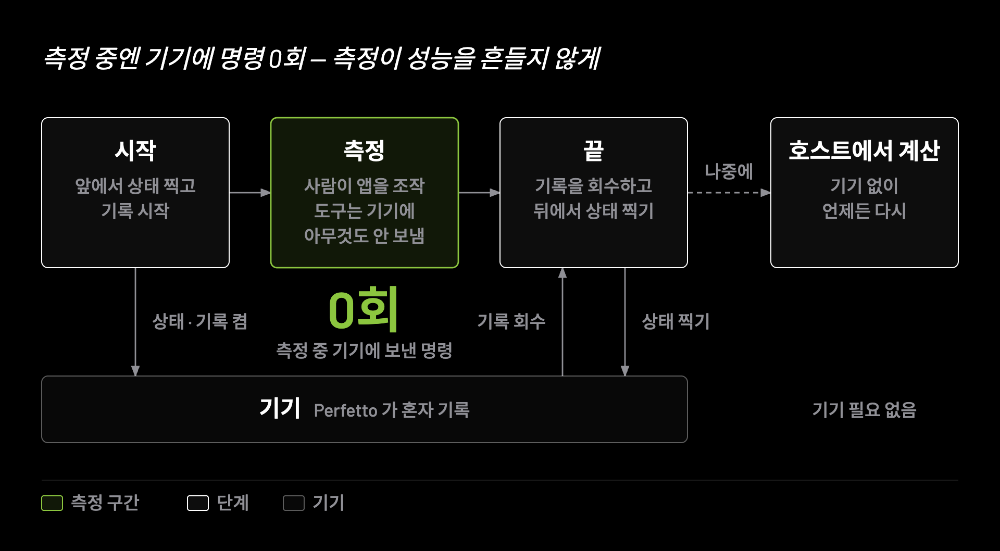

# 자세한 사용법

[README](../README.md) 에서 한 줄로 줄인 것들의 자세한 설명입니다. `result.json` 필드는 [result-json.md](result-json.md) 에 있습니다.

## 지원 버전

**Android 11(sdk 30)부터 동작합니다.** 두 지표에만 더 높은 하한이 있습니다:

| 지표 | 최소 | 왜 |
| --- | --- | --- |
| `network` | **Android 14** (sdk 34) | `dumpsys netstats` 의 `mAppUidStatsMap` 절이 그때부터입니다 |
| `frame` | **Android 12** (sdk 31) | `android.surfaceflinger.frametimeline` 데이터소스가 그때부터입니다 |
| 나머지 6개 | Android 11 | thermal 만 sdk 29 하한이 따로 있습니다 |

**렌더링 집계(`hwui`)는 어느 기기에서나 볼 수 있습니다.** `dumpsys gfxinfo` 에서 와서 버전
하한이 없습니다 — 실측 SM-A405S(sdk 30)에서도 전체 799장·분포 70칸이 나왔습니다.
**렌더링의 시간축(`frame`)은 다릅니다** — sdk 31 미만에서는 `metrics.frame` 이
`sdk_too_low` 로 나옵니다 (`hwui` 는 그 기기에서도 그대로 나옵니다).

**기기를 꽂고 `perftracker doctor` 를 돌리면 그 기기에서 무엇을 잴 수 있는지 알려줍니다:**

```
✗ metric: network   이 기기에서는 측정할 수 없습니다 — sdk_int=30 로는 수집할 수 없습니다 (최소 34, Android 14)
✓ metric: hwui      측정 가능
✓ metric: startup   측정 가능
✓ metric: cpu       측정 가능
...
✗ metric: network   이 기기에서는 측정할 수 없습니다 — sdk_int=30 로는 수집할 수 없습니다 (최소 34, Android 14)
```

못 재는 지표가 있어도 **`doctor` 는 실패하지 않습니다**(종료 코드 0). 그건 고칠 수 없는
기기의 성질이지 환경 오류가 아니기 때문입니다 — `adb` 를 못 찾는 것과는 다릅니다.
`start` 도 세션을 열면서 같은 목록을 한 번 더 보여줍니다.

---

## 이 도구가 지키는 두 가지

### 1. 측정이 측정 대상을 바꾸지 않는다

`start` 가 끝난 순간부터 `stop` 을 부를 때까지 **기기에 단 한 개의 adb 명령도 나가지 않습니다.**



한 가지는 나란히 알아야 합니다. **트레이스는 `start` 가 끝나기 전에 이미 시작합니다** —
그래야 콜드 스타트가 트레이스 안에 들어갑니다. `--launch` 를 주면 트레이스가 켜진 뒤,
래치가 걸리기 전에 perftracker 자신이 `am start -W`(앱 실행 + 시작 시간)와 `pidof`(앱 pid)를
한 번의 adb 호출로 보냅니다. 앱을 콜드로 띄우는 것이 그 세션의 목적이므로 의도된 동작이지만,
"트레이스 구간 안의 adb 호출이 0" 이라는 뜻은 아닙니다. 그 뒤로는 0 입니다.

진단 세션(`--diagnose`)에서 `--launch` 를 주면 그 같은 호출의 맨 앞에 **atrace 켜짐 대기**가
붙습니다 — `getprop` 으로 `debug.atrace.tags.enableflags` 와 `debug.atrace.app_number` 를 **읽기만**
하며 둘 다 켜질 때까지 최대 5초 기다린 뒤 앱을 띄웁니다. 트레이스는 atrace 가 켜지기 전에
시작하므로, 기다리지 않으면 그 사이에 뜬 앱의 `bindApplication` slice 가 빠집니다 (실기기에서
기다리지 않은 회 0개 · 기다린 회 1개). adb 호출은 그대로 한 번이고, 평소 세션에는 붙지 않습니다.

`--compile` 은 반대로 **기기를 일부러 바꿉니다** — 앱의 컴파일 상태를 맞춰 재려고 사람이 켜는 옵션이고, 그 변경은
세션이 끝나도 남습니다. 그래서 측정 창 **밖**, 트레이스 · 시작 스냅샷보다 앞에서 끝내고, 바꾼 사실을
`result.json` 의 [`session.compile`](result-json.md#sessioncompile--바꾼-기록) 에 남깁니다. `--compile` 을 주지 않은 세션은
컴파일 상태를 바꾸는 명령을 하나도 보내지 않습니다.

이건 "그러려고 노력한다" 가 아니라 구조입니다. 세션이 살아 있는 동안 모든 adb 접근 경로에
래치(`MeasurementWindow`)가 걸리고, 기기를 만지려는 명령은 예외로 막힙니다.
세션 중에 `perftracker apps` 를 실행하면 이렇게 됩니다:

```
측정 창이 열려 있는 동안 adb 명령을 시도했습니다: adb -s <serial> shell pm list packages -3
측정 중 기기 접촉은 관찰자 효과를 만들므로 금지됩니다.
```

래치는 프로세스 경계를 넘습니다 — `start` 와 `stop` 은 서로 다른 프로세스지만,
새 프로세스는 활성 세션 포인터를 읽고 창을 복원합니다. 그리고 막힌 호출의 **횟수**를 세어
`result.json` 의 `measurement_overhead.adb_commands_during_session` 에 적습니다.
그 값이 0 이 아니면 그 세션 데이터는 오염된 것으로 봐야 합니다.
(이 카운터가 세는 것은 **이 도구를 통과한** 호출뿐입니다. 자세한 한계는
[아래](result-json.md#measurement_overhead)에 적어 두었습니다.)

횟수는 창이 열려 있는 동안 활성 세션 포인터에 쌓이고 `stop` 이 그것을 거둡니다.
그래서 아직 `stop` 하지 않은 세션에 `extract` 를 돌리면 이 값은 **최종값이 아닙니다** —
그때까지의 누적이거나, 포인터마저 없으면 `null`(= 셀 수 없었다)입니다.
`null` 을 0 으로 접어 읽지 마세요.

이 제약이 설계 전체를 결정합니다:

- 트레이스는 Perfetto `--detach` 세션으로 남깁니다. 도구가 아무것도 붙잡고 있지 않아도
  기기가 알아서 기록하므로, 측정 중 왕복이 필요 없습니다.
- 트레이스는 세션 중에 회수하지 않습니다. `stop` 때 한 번에 flush 하고 pull 합니다.
- 고빈도 ftrace 이벤트(`sched/sched_switch` 등)는 **설정 단계에서 거부됩니다.**
  그것들은 켜는 것만으로 기기에 부하를 줍니다. 폴링 주기는 1000ms 이상만 허용됩니다.
- 모든 파싱은 호스트에서 합니다. `extract` 단계는 기기에 접촉하지 않습니다.
- `doctor` 와 `devices` 조차 측정 중인 기기는 건드리지 않습니다.

### 2. 판정하지 않는다

`result.json` 에는 "좋다 / 나쁘다 / 느리다" 가 없습니다. 측정값과 관측된 사실만 있습니다.

구글이 공개한 기준치(60fps 예산 16.67ms, frozen frame 700ms)는 값 옆이 아니라
**별도의 `references` 배열에 사실로 기록**되고, 도구는 그것과 비교하지 않습니다.
비교는 이 데이터를 소비하는 쪽(CI, 리포트, 사람)이 합니다.

`warnings` 에도 평가는 없습니다. "USB 충전 중이었음", "저전력 모드가 켜져 있었음" 처럼
관측된 사건만 들어갑니다.

**터미널에도 요약을 찍지 않습니다.** `stop` 과 `extract` 는 `result.json` 의 경로만 알려주고
끝납니다. 어느 지표를 앞에 둘지, 무엇을 굵게 쓸지 자체가 이미 판단이고, 요약을 만들려면
"무엇이 중요한가" 를 도구가 정해야 하기 때문입니다. 산출물은 `result.json` 하나입니다.

값을 안 찍는 것과 **다음에 무엇을 열면 되는지 안 알려주는 것은 다릅니다.** `stop` 은 경로
아래에 보고서를 만드는 명령 한 줄을 같이 냅니다 — 그 줄은 그대로 쳐서 도는 명령입니다.

---

## 설치

**Node 20.19 이상**과 **adb**(Android Platform Tools)가 필요합니다. 그 둘뿐입니다 —
기기에 설치할 것도, 앱에 넣을 것도 없습니다.

```bash
npx perftracker doctor        # 설치 없이 바로. 이 기기에서 뭘 잴 수 있는지 알려줍니다
```

자주 쓰면 전역으로 두는 편이 낫습니다.

```bash
npm i -g perftracker
perftracker doctor
```

### 저장소에서 직접 쓸 때

npm workspaces 를 쓰는 모노레포라 **저장소 루트에서 한 번** `npm install` 하면
`packages/*` 가 함께 설치되고 서로 링크됩니다. 패키지 디렉토리 안에서 따로 설치하지 마세요.

```bash
git clone https://github.com/KimHance/PerfTracker.git && cd PerfTracker
npm install
npm run build        # tsc --build + 화면 빌드. dist/ 와 dist-web/ 이 있어야 돕니다
npx perftracker doctor
```

런타임 의존성은 `zod` 와 `commander` 둘뿐입니다. 안드로이드 SDK 도, Gradle 도,
JDK 도 필요 없습니다 — 이 도구는 앱을 빌드하지 않습니다.

### `adb`

다음 순서로 찾습니다. 하나만 되면 됩니다.

1. `--adb <경로>` 옵션
2. `PERFTRACKER_ADB` 환경변수
3. `PATH`
4. `ANDROID_HOME` / `ANDROID_SDK_ROOT` 의 `platform-tools/`
5. OS 기본 SDK 경로 (macOS 는 `~/Library/Android/sdk`)

**`adb` 가 `PATH` 에 없는 것이 드문 일이 아닙니다.** Android Studio 만 깔면 보통 그렇습니다.
이 저장소의 개발 맥에서도 그랬고, 실제 경로는
`~/Library/Android/sdk/platform-tools/adb` 였습니다. 4·5번 규칙이 그 경우를 덮으므로
대개는 아무것도 안 해도 되지만, SDK 를 기본 위치가 아닌 곳에 두었다면:

```bash
export PERFTRACKER_ADB="$HOME/Library/Android/sdk/platform-tools/adb"
# 또는
export ANDROID_HOME="$HOME/Library/Android/sdk"
```

`perftracker doctor` 가 무엇을 찾았는지 그대로 보여줍니다. 막히면 거기서부터 보세요.

### 기기

준비물은 **USB 디버깅 켜기**가 전부입니다. 기기에 아무것도 설치하지 않고 루팅도 필요 없습니다.

- **Android 12(API 31) 이상**이어야 프레임 타이밍(`android.surfaceflinger.frametimeline`)을
  얻을 수 있습니다.
- **`metrics.network` 은 Android 14(sdk 34) 이상**에서만 나옵니다 (아래 해당 절 참고).
- **기기를 하나만 연결해 두세요.** 에뮬레이터를 함께 켜 두면 기기가 둘이 되어
  `AmbiguousDeviceError` 가 납니다. 굳이 둘을 두려면 `-d, --device <serial>` 로 지목하세요
  (단 온-디바이스 테스트는 serial 을 넘기지 않습니다 — 아래 "개발" 참고).

### 트레이스 파서 (`trace_processor_shell`)

**따로 설치하지 않습니다.** 첫 `stop`(또는 `extract`) 때 자동으로 내려받아
`~/.perftracker/bin/` 에 캐시합니다. 받은 바이트는 **크기와 SHA256 을 둘 다 검증**한 뒤에만
저장하므로, 프록시가 중간에서 응답을 바꾸면 조용히 넘어가지 않고 실패합니다.
(고정 버전은 `perfetto/traceProcessor/locate.ts` 의 `TRACE_PROCESSOR_VERSION` 하나가
소유합니다. 현재 `v57.2`, 약 12~14MB.)

- 네트워크를 쓰고 싶지 않으면 `--offline` 을 주세요. 캐시가 없으면 **받을 URL 과 둘 자리를
  오류 메시지에 찍고** 멈춥니다 — 그 파일을 손으로 받아 그 경로에 두면 됩니다.
- 이미 가진 바이너리를 쓰려면 `PERFTRACKER_TRACE_PROCESSOR` 에 절대 경로를 주세요.
- 캐시 위치를 옮기려면 `PERFTRACKER_HOME` 을 바꾸세요 (기본 `~/.perftracker`).
  이 디렉토리에는 활성 세션 포인터(`active/<serial>.json`)도 함께 삽니다.
- 회사 방화벽 등으로 `commondatastorage.googleapis.com` 이 막혀 있으면 다른 머신에서 받아
  옮긴 뒤 `PERFTRACKER_TRACE_PROCESSOR` 로 지정하는 것이 가장 빠릅니다.

---

## 사용법

```bash
# 0) 환경과 기기가 준비됐는지 본다
npx perftracker doctor

# 1) 측정 시작 (앱을 콜드로 띄우고 싶으면 --launch)
npx perftracker start --app YouTube --name "홈 스크롤" --launch

# --- 여기서 손으로 앱을 조작한다. 이 동안 도구는 기기를 건드리지 않는다 ---

# 2) 얼마나 지났는지 확인 (기기에 접촉하지 않는다)
npx perftracker status

# 3) 종료 — 트레이스를 회수하고 result.json 을 만든다
npx perftracker stop
npx perftracker stop --report      # 보고서(HTML)까지 만들고 브라우저로 연다
```

`stop` 은 `result.json` 의 경로와 **보고서를 만드는 명령**을 냅니다:

```
→ /…/runs/2026-07-26T02-31-40_홈-스크롤_a3f9c1/result.json
  perftracker report a3f9c1 로 보고서를 엽니다
```

`--report` 는 그 한 줄을 대신 쳐 주는 것입니다. 기본값이 아닌 이유는 보고서가 화면 자산을
필요로 하기 때문입니다 — npm 으로 받았으면 이미 들어 있고, 저장소에서 직접 쓸 때만
`npm run build` 가 한 번 돌아 있어야 합니다.

`start` 는 앱을 **라벨로도 패키지명으로도** 찾습니다(`--app` 생략 시 지금 포그라운드에 있는 앱).
설치된 앱 목록은 `perftracker apps` 로 볼 수 있습니다.

세션 하나가 디렉토리 하나입니다:

```
runs/2026-07-26T02-31-40_홈-스크롤_a3f9c1/
  result.json              ← 최종 산출물
  trace.perfetto-trace     ← Perfetto 원본 (Perfetto UI 로 열 수 있다)
  capture.json             ← 캡처 단계의 기록 (기기 스펙, 스냅샷, 경고)
  session.json             ← 세션 메타
  raw/                     ← dumpsys 원문 (before / after)
```

원본이 남아 있으므로 **기기 없이 언제든 다시 산출**할 수 있습니다:

```bash
npx perftracker extract runs/2026-07-26T02-31-40_홈-스크롤_a3f9c1
```

파싱 규칙이 바뀌었을 때, 다른 사람이 뜬 트레이스를 받았을 때 유용합니다.

### 문제 해결

- **`stop` 이 트레이스 회수에 실패했다** — 세션은 그대로 남습니다. 기기의 트레이스도
  지우지 않습니다. `perftracker stop` 을 그냥 다시 실행하면 그 지점부터 재개합니다.
- **`stop` 은 됐는데 `result.json` 산출이 실패했다** — 원본은 이미 안전합니다.
  오류 메시지에 있는 run 디렉토리로 `perftracker extract` 를 돌리세요.
- **이미 세션이 있다고 한다** — `perftracker stop` 으로 끝내거나 `--force` 로 시작하세요.
  `--force` 는 기기 쪽에 남은 Perfetto 세션까지 정리합니다.

### 측정 중에 무슨 일이 있었는지 적어 두기 (`mark`)

시계열(`timeline`)은 "3초에 CPU 가 뛰었다" 는 말해 주지만 **그 3초가 무엇이었는지**는 말해
주지 못합니다. 그것을 아는 것은 기기 앞에 있던 사람뿐이고, 그 순간에 적어 두지 않으면 다시는
복원되지 않습니다.

```bash
# 측정이 도는 동안, 다른 터미널에서
npx perftracker mark "홈 진입"
npx perftracker mark "스크롤 시작" --session a3f9c1   # 세션이 여럿이면 고유값으로 지정
npx perftracker mark "광고 재생" -d <serial>       # 기기로 지정해도 됩니다
```

**이 명령은 기기에 아무것도 보내지 않습니다.** 호스트의 세션 파일만 고치므로 측정 창(§"이
도구가 지키는 두 가지")을 깨지 않습니다. 정지하면 `result.json` 의 `session.marks[]` 에
세션 시작으로부터의 경과와 함께 들어갑니다:

```json
"session": {
  "marks": [
    { "offset_ms": 11353, "label": "홈 진입" },
    { "offset_ms": 13373, "label": "스크롤 시작" }
  ]
}
```

**`offset_ms` 는 시계열의 `t_s` 와 0초가 다릅니다.** 마킹은 **세션 시작**(호스트 시계)이 0이고
시계열은 **트레이스 시작**(기기 시계)이 0인데, `start` 가 adb 왕복을 하는 동안 트레이서는 아직
돌지 않습니다 — 실측 0.82초 차이입니다. 시계열 위에 얹으려면 그만큼 당기세요:

```
t_s = (offset_ms − session.trace_start_offset_ms) / 1000
```

`trace_start_offset_ms` 가 `null` 이면 두 축의 관계를 모르는 것이므로 **옮기지 마세요.**
0으로 가정하면 어긋난 자리에 찍히면서 맞는 것처럼 보입니다.

진행 중인 세션이 하나뿐이면 아무것도 지정하지 않아도 되고, 둘 이상인데 지정하지 않으면
**아무 데도 붙이지 않고 어느 세션인지 묻습니다.**

### 브라우저 화면 (`open`)

같은 흐름을 브라우저에서 할 수 있습니다.

```bash
npx perftracker open           # 서버가 뜨고 브라우저가 열립니다
npx perftracker open -p 7333   # 포트를 고정하고 싶으면
```

**이 명령은 끝나지 않습니다** — Ctrl-C 까지 서버를 붙잡습니다.

> 저장소에서 직접 쓸 때는 `npm run open` 이 빌드까지 함께 합니다.

> 예전 이름 `gui` 도 그대로 받습니다. 별칭으로 남겨 뒀습니다.

세션을 **동시에 여러 개** 돌릴 수 있게 브라우저 탭처럼 상단 탭바로 나뉘고, 기기를 고르면 그
기기에서 못 재는 지표를 **시작 전에** 알려 줍니다. 측정 중 화면에는 경과 시간과 정지 버튼,
그리고 마킹 입력만 있습니다 — 화면에서 남긴 마킹과 터미널에서 `perftracker mark` 로 남긴
마킹은 **같은 자리에 쌓입니다.**

| 옵션 | |
| --- | --- |
| `-p, --port <포트>` | 고정 포트 (생략하면 빈 포트를 고릅니다) |
| `-o, --out <dir>` | 결과를 저장할 디렉토리 (기본 `runs`) |
| `--no-browser` | 브라우저를 자동으로 열지 않습니다 |

서버는 **127.0.0.1 에만 붙습니다.** 이 서버는 연결된 기기에 adb 를 보내고 run 디렉토리를 지울
수 있어서, 같은 네트워크의 다른 사람에게 열어 줄 이유가 없습니다.

브라우저를 새로고침해도 측정 중인 세션은 그대로 돌아옵니다 — 경과 시간도 0부터 다시 세지 않고
이어집니다. 터미널에서 `perftracker start` 로 연 세션도 화면에 나타납니다.

**기록을 클릭하면 세션 보고서가 새 창으로 열립니다.** `result.json` 에 있는 것이 전부
그려집니다 — 프레임 분포, 시계열 다섯, 기기·앱 정보, 경고, 측정 비용. 주소에 run id 가 있어
(`?report=<id>`) 그대로 공유할 수 있습니다.

시계열 하나에 마우스를 올리면 **나머지 시계열이 같은 초를 가리킵니다.** 마킹을 남겼다면
그 시각이 세로선으로 모든 그래프에 얹히고, 마커를 짚으면 그 순간의 값이 한꺼번에 읽힙니다.

보고서는 **판정하지 않습니다.** 점수도, 등급도, "좋다/느리다" 도 없습니다 (「이 도구가 지키는 두 가지」의
2번). 예외는 **둘뿐이고 둘 다 같은 조건**을 지킵니다 — 앱 시작 카드의 기준선 막대(첫 번째)와
프레임 타임라인의 16ms 참고선(두 번째)입니다. 경계를 우리가 정하지 않고(구글이 공개한 값을
출처와 함께 옮겨 적습니다), 점수도 이름도 붙이지 않으며, **그 선으로 값을 분류하지 않습니다** —
참고선을 넘었다고 막대 색이 달라지지 않습니다.
못 잰 값은 `수집 안 함`(이 도구가 그 값을 낼 줄 모르던 시절의 세션)과 `값 없음`(재려다
못 잼)으로 **다르게** 적히고, 어느 쪽이든 카드가 사라지지는 않습니다.

---

## 명령 전체

위 흐름에 나오지 않는 것까지 포함한 목록입니다. **실제로 측정하는 것은 `start` 와 `stop`
둘뿐이고** 나머지는 점검·조회·마킹·기록 관리입니다.

| 명령 | 무엇 | 기기 |
| --- | --- | --- |
| `perftracker doctor` | 환경과 기기 지원 여부를 점검 | 필요 |
| `perftracker devices` | 연결된 기기와 스펙 요약 | 필요 |
| `perftracker apps` | **열 수 있는** 앱을 런처 이름으로 (런처에 아이콘이 뜨는 것) | 필요 |
| `perftracker schema` | `result.json` 의 JSON Schema 를 출력 | 불필요 |
| `perftracker start` | 측정 시작 (`--diagnose` 면 진단 세션 · `--launch --compile <값>` 이면 컴파일 상태를 바꾼 뒤) | 필요 |
| `perftracker mark <라벨>` | 측정 중인 세션에 마킹 | **접촉 안 함** |
| `perftracker status` | 진행 중인 세션 | **접촉 안 함** |
| `perftracker stop` | 종료 · 트레이스 회수 · `result.json` 생성 (`--report` 면 HTML 까지) | 필요 |
| `perftracker extract <run-dir>` | 원본을 다시 파싱해 `result.json` 재생성 | 불필요 |
| `perftracker runs list` | 기록 목록 | 불필요 |
| `perftracker runs rename <id> <이름>` | 기록 이름 변경 (디렉토리 경로는 그대로) | 불필요 |
| `perftracker runs rm <id>` | 기록 삭제 (run 디렉토리째) | 불필요 |
| `perftracker report <id>` | 기록을 **파일 하나짜리 HTML** 로 (서버 불필요) | 불필요 |
| `perftracker open` | 화면을 띄웁니다 — 로컬 서버 (Ctrl-C 까지 붙잡습니다) | 필요 |

「접촉 안 함」은 기기가 연결돼 있어도 adb 를 **보내지 않는다**는 뜻입니다. 그래서 이 셋은
측정 중에 불러도 안전합니다 — 마킹이 측정 결과를 바꾸지 않는 이유가 이것입니다.

### 진단 세션 (`--diagnose`)

평소 세션은 수치만 냅니다. 그 시간에 앱이 **무엇을** 했는지(atrace slice 이름)를 보려면
진단 세션으로 엽니다.

```bash
npx perftracker doctor                       # diagnose: app slice 줄 — 이 기기에서 앱 slice 가 열리나
npx perftracker start --app "네이버 웹툰" --launch --diagnose
npx perftracker status                       # Diagnose 줄
npx perftracker stop                         # 평소와 같습니다 — 경로와 보고서 명령만
```

- **기록하는 것** — atrace 카테고리 `am` · `wm` · `view` · `dalvik` 와 대상 앱 하나의 앱 slice 입니다.
  `dalvik` 은 ART 가 남기는 slice(dex 를 열 때의 컴파일 상태 · JIT 컴파일 · 클래스 이름)이고, 그 가운데 컴파일
  상태와 JIT 수가 진단 블록의 [ART 칸 둘](result-json.md#diagnose)로 실립니다. gfx · input · sched 는 켜지 않습니다.
- **최대 10분입니다** (평소 세션은 30분). `status` 의 최대 시간 넘음 안내도 진단 세션은 10분 기준입니다.
- **평소 세션과 수치를 나란히 놓을 수 없습니다.** slice 하나를 남기는 비용은 앱 프로세스
  자신에게 청구되고 `measurement_overhead` 에 잡히지 않습니다. 그래서 진단 세션은 눈에 띄게
  갈립니다 — `start` · `status` 에 `Diagnose` 줄, `runs` 행 끝에 `진단`.
  `status --json` · `runs --json` 도 **진단 세션에만** 진단 표시를 싣습니다
  (`status` 는 `session.options.diagnose` · `session.diagnose`, `runs` 는 `diagnose: true`).
  평소 세션의 JSON 은 키가 진단 모드 이전과 같습니다.
- **앱 slice 가 열리는 조건** — sdk 31 이상이면 앱과 무관하게 열립니다. sdk 30 이하는
  debuggable 앱만 열리고, 그 밖의 앱이면 세션은 열되 `start` 가 `앱 slice 열림 모름 — …`
  줄을 냅니다. **실측은 sdk 35(에뮬레이터) · 36(SM-S901N) 뿐입니다** — sdk 31–34 와
  sdk 30 이하는 안드로이드 문서(`profileable` 요소) 근거이고 실기기로 확인하지 않았습니다.
  프레임워크 slice(`am` · `wm` · `view` · `dalvik`)는 그대로 실립니다. `doctor` 의
  `diagnose: app slice` 줄이 기기 단위로 같은 판정을 미리 보여 줍니다 (✗ 여도 종료 코드 0).
- `stop` · `extract` 의 출력은 평소와 같습니다 — slice 요약을 찍지 않습니다. slice 는
  `result.json` 에 실리고(아래 「`result.json` 읽는 법」), 시간축으로 보려면 run 디렉토리의
  `trace.perfetto-trace` 를 [Perfetto UI](https://ui.perfetto.dev) 로 엽니다.

### 컴파일 상태를 맞춰 재기 (`--compile`)

같은 앱이라도 컴파일 상태(`speed-profile` · `verify` · `speed` …)에 따라 콜드 스타트 · 스크롤 수치가 달라집니다.
상태를 맞춰 다시 재려면 `--compile <reset|speed-profile|speed>` 를 줍니다. **`--compile` 은 `--launch` 와만 받습니다** —
`--launch` 없이 주거나 셋 밖의 값을 주면 기기에 명령을 하나도 보내지 않고 거부합니다. 이미 떠 있는 앱은 옛 컴파일
결과로 돌 수 있기 때문입니다. (`--help` 의 설명 줄은 80칸이라 이 조건을 싣지 않습니다.)

```bash
npx perftracker start --app com.google.android.youtube --launch --compile speed
npx perftracker status                       # Compile 줄
npx perftracker stop                         # 경로 · 보고서 명령 + 되돌림 줄
```

- **기기를 영구히 바꿉니다** — 세션이 끝나도 남습니다. 보낸 명령 · 바꾸기 전 상태 · 걸린 시간은
  [`session.compile`](result-json.md#sessioncompile--바꾼-기록) 에 남습니다.
- `start` · `status` 에 `Compile   speed · base.apk speed-profile → speed · 67,500 ms` 줄이 붙습니다 — base.apk 줄의
  바꾸기 전 → 뒤 `status`(compiler filter)와 상태를 바꾸는 데 걸린 시간입니다. 읽지 못한 쪽은 `모름` 입니다.
  `status` 는 기기에 묻지 않고 run 디렉토리의 기록(`capture.json`)을 읽습니다.
- **도구는 되돌리지 않고, 되돌림 명령 줄을 냅니다.** `start` 와 `stop` 출력에 — 상태 바꾸기가 실패했거나 바꾼 뒤
  세션 시작이 실패해 오류로 끝날 때도 — 호스트에서 그대로 쳐서 도는 줄이 붙습니다:

  ```
  되돌림 · 실행 뒤 reason = cmdline · 기기가 다시 바꿀 수 있음
    adb -s <serial> shell cmd package compile -m speed-profile -f com.google.android.youtube
    adb -s <serial> shell cmd package compile -m verify -f --secondary-dex com.google.android.youtube
  ```

  바꾸기 전 base.apk 줄의 `status` 로 `-m` 을 채우고, 보조 dex 가 있고 그 `status` 가 모두 같으면 `--secondary-dex`
  줄이 하나 더 붙습니다. `-m` 이 받는 값은 sdk 36 기기 도움말 실측의 `speed` · `speed-profile` · `verify` 셋입니다.
  base.apk 와 보조 dex 는 **따로** 봅니다 — 어느 쪽이든 되돌릴 수 없으면(바꾸기 전 `status` 가 그 셋 밖 · 읽지 못함 ·
  보조 dex 끼리 서로 다름) 명령 대신 **그 사실 한 줄**이 나오고, 다른 쪽 명령은 그대로 나옵니다. 되돌릴 수 없는
  dex 가 있다는 사실을 줄로 남기는 것은, 줄이 없으면 다 되돌렸다고 믿게 되기 때문입니다. 대상 앱만 다루고, 명령
  줄은 자르지 않아 80칸을 넘습니다. serial 에 셸이 해석하는 글자가 있으면(IPv6 `[fe80::1]:5555` 등) 작은따옴표로
  감쌉니다. 되돌려도 처음과 똑같아지지 않는 이유는 [`session.compile` 의 한계](result-json.md#sessioncompile--바꾼-기록)에 있습니다.
- `stop` 이 `result.json` 산출에 실패해 오류로 끝나거나 화면(`open`)에서 세션을 멈추면 되돌림 줄이 나오지
  않습니다 — 그때는 run 디렉토리 `session.json` 의 `compile.compile_state_before` 가 바꾸기 전 상태입니다.
- `status --json` 은 `compile`(`value` · `baseStatusBefore` · `baseStatusAfter` · `elapsedMs`)을, `runs --json` 은
  행마다 같은 꼴의 `compile` 을 **`--compile` 세션에만** 싣습니다 — 평소 세션의 JSON 은 키가 이 옵션 이전과
  같습니다. 모르는 칸은 `null` 이고, `runs` 의 `baseStatusAfter` 는 `result.json` 이 있는 기록에서만 읽습니다.
- `--compile` 없는 세션의 `start` · `stop` · `status` 출력은 이 옵션 이전과 같습니다.

### 기록 관리 (`runs`)

측정이 끝난 뒤의 파일 정리입니다. **GUI 의 기록 목록과 같은 일을 합니다** — 한쪽에만 있는
기능을 만들지 않는 것이 이 도구의 규칙이고, 판정과 파일 조작은 양쪽 다 core 의 같은 코드를
부릅니다.

```bash
npx perftracker runs                          # 목록 (list 가 기본)
npx perftracker runs rename a3f9c1 "홈 스크롤 2차"
npx perftracker runs rm a3f9c1                # 되돌릴 수 없습니다
npx perftracker runs rm --all --yes           # 전부 (--yes 없으면 거부합니다)
```

`rm` 은 **기록이 아닌 폴더도 지웁니다.** `start` 가 죽어 `session.json` 조차 없는 폴더는
목록에 안 뜨는데, 그런 것까지 지워야 "전부 지웠다" 가 사실이 됩니다. 다만 **측정 중인 세션의
폴더는 남깁니다** — 그 자리는 `stop` 이 트레이스를 회수해 쓸 곳입니다.

`--all` 이 `--yes` 를 요구하는 것은 되묻지 않기 위해서입니다. CI 에서 입력을 기다리면 빌드가
타임아웃까지 매달립니다. id 를 직접 적은 삭제는 그 자체가 의사 표시라 묻지 않습니다.

### 보고서를 파일 하나로 (`report`)

`gui` 와 **같은 화면**인데 서버가 없습니다. 자산과 데이터를 전부 문서 안에 말아 넣어 더블클릭
하면 열리는 HTML 하나를 냅니다.

```bash
npx perftracker report bc7a6a                 # → runs/<…>/report.html (브라우저가 열립니다)
npx perftracker report bc7a6a --file /tmp/r.html
npx perftracker report bc7a6a --no-browser    # CI
npx perftracker stop --report                 # 측정을 끝내면서 바로 (--no-browser 도 같습니다)
```

**파일 하나로 만드는 이유.** 측정한 사람과 읽는 사람이 다른 경우가 보통이고, 그때 "서버를 띄우고 이
포트를 열어라" 는 전달 방법이 못 됩니다. 첨부해서 보내면 끝나야 합니다.

글꼴 6개까지 data URI 로 넣어 **외부로 나가는 요청이 0** 입니다 (약 430KB). 인터넷 없는
자리에서도, 이 도구가 없는 컴퓨터에서도 그대로 뜹니다.

`-o` 는 다른 명령과 **같은 뜻**(기록이 있는 디렉토리)이고 쓸 자리는 `--file` 입니다 —
한 글자를 명령마다 다른 뜻으로 쓰면 그것이 가장 비싼 종류의 함정이 됩니다.

### 조회 결과를 JSON 으로 (`--json`)

`doctor` · `devices` · `apps` · `status` · `runs` 는 `--json` 을 받습니다.

```bash
npx perftracker doctor --json     # 이 기기가 무엇을 잴 수 있는지 기계가 읽는 형태로
npx perftracker devices --json
```

**사람이 읽는 문장이 기본이고 이것은 추가 모드입니다** — 사람과 기계(CI · LLM)가 둘 다
소비자입니다. `start` / `stop` / `mark` 에는 없습니다: 그 셋의 출력은 이미 한 줄(경로 하나)이고,
시작 전에 알아야 할 것은 `doctor --json` 이 전부 줍니다.

---

## 개발

**여기서부터는 저장소에서 직접 작업하는 사람용입니다.** npm 으로 받아 쓰는 데는
필요 없습니다 — 소스는 [https://github.com/KimHance/PerfTracker](https://github.com/KimHance/PerfTracker) 에 있습니다.

```bash
git clone https://github.com/KimHance/PerfTracker.git && cd PerfTracker
npm install
npm run build     # 먼저 한 번 — 아래 테스트가 core 의 dist/ 를 씁니다
npm test          # 유닛 테스트 (기기 불필요). 1초 남짓
npm run typecheck # src + test 전체 타입체크
npm run test:device   # 온-디바이스 스펙 (기기가 꽂혀 있어야 함) — 현재 27개
```

**갓 클론한 저장소에서는 `npm run build` 가 먼저입니다.** `packages/cli` 의 테스트가
`@perftracker/core` 를 `dist/` 로 해석하므로, 빌드 없이 `npm test` 를 돌리면 스위트 하나가
`Failed to resolve entry for package "@perftracker/core"` 로 실패합니다.

- `packages/core` — 기기·세션·수집·파싱. 도메인 로직 전부.
- `packages/cli` — 얇은 껍데기. 명령 조립과 출력 포맷만.

`core` 는 구체 프로세스 실행기를 공개하지 않습니다. 기기 접촉은 `AdbClient` 를 통해서만
가능하고, 그래야 측정 창 래치를 우회할 수 없습니다.

새 메트릭을 붙이려면 `Collector` 를 하나 만들어 `collectors/registry.ts` 의
`COLLECTORS` 에 넣으면 됩니다. `start` 가 TraceConfig 블록을 모으고 `extract` 가
`metrics[collector.id]` 를 채우는 것은 그 배열을 순회해서 일어납니다.

### 온-디바이스 테스트를 다른 기기에서 돌리기

**이것을 먼저 읽지 않으면 새 기기에서 `npm run test:device` 가 실패합니다.**

세션을 여는 온-디바이스 스펙은 대상 앱을 **고정**합니다. 기본값은
**`com.google.android.youtube`**(YouTube)이고, 그 앱이 없는 기기에서는 실패합니다.

**컴파일 상태 스펙(`baseline.test.ts`, 6개)은 `PERFTRACKER_TEST_COMPILE=1` 일 때만 돕니다.** 그 기기의 YouTube
컴파일 상태를 바꾸기 때문입니다 — 되돌림 줄을 실행해도 `reason` 은 `cmdline` 으로 남습니다.

```bash
PERFTRACKER_TEST_COMPILE=1 npm run test:device   # 컴파일 상태 스펙까지
```

```bash
# 이 기기에 있는 서드파티 앱 하나를 골라 덮는다
PERFTRACKER_TEST_APP=<패키지명> npm run test:device

# 기기가 두 대 이상 꽂혀 있으면 어느 기기인지도 지정해야 한다
PERFTRACKER_TEST_DEVICE=<serial> PERFTRACKER_TEST_APP=<패키지명> npm run test:device
```

**기기가 둘이면 지정하지 않은 채로는 스펙이 하나도 돌지 못합니다** (`AmbiguousDeviceError`).
기기를 시험 안에서 잡는 11개는 실패로, 기기를 `beforeAll` 에서 잡는 진단 스펙(`diagnose.test.ts`) 9개는
건너뜀으로 셉니다 — vitest 는 `beforeAll` 이 던지면 그 안의 시험을 건너뜀으로 세고 그 파일은 실패로 냅니다.
실측(2026-10-08, 실기기 + 에뮬레이터를 같이 연결): `Test Files 5 failed (5)` · `Tests 11 failed | 9 skipped (20)` ·
종료 코드 1. 한 대만 꽂혀 있으면 `PERFTRACKER_TEST_DEVICE` 는 필요 없습니다.

고를 앱의 조건은 둘입니다.

1. **런처 액티비티가 있어야 합니다.** `--launch` 가 그것으로 콜드 스타트합니다.
   런처처럼 진입점이 없는 앱을 고르면 `No activity found` 로 거부됩니다.
2. **강제 종료돼도 괜찮은 앱이어야 합니다.** `--launch` 는 `am force-stop` 후 재실행이라
   스펙을 돌릴 때마다 그 앱이 죽고 화면에 튀어나옵니다. 설치된 앱은
   `npx perftracker apps` 로 볼 수 있습니다.

앱이 없으면 스펙은 **조용히 건너뛰지 않고 실패합니다.** 무엇이 없어서 못 도는지와 어떻게
바꾸는지를 메시지에 적습니다 (`assertTargetAppInstalled`). 건너뛰기를 넣지 않은 이유는
단순합니다 — 건너뛴 스펙은 통과한 스펙과 같은 색으로 보이고, 그러면 이 스펙이 지키려는 것이
아무 데서도 지켜지지 않습니다.

**고정하는 이유.** 예전에는 CLI 기본값(포그라운드 앱)을 그대로 썼습니다. 그래서 **사람이
화면에 무엇을 두었는가가 테스트의 커버리지와 결과를 정했습니다.** 5회 연속 실행이 그것을 두
모양으로 드러냈습니다 — 포그라운드가 우연히 설정 앱이라 시스템 앱 경로만 밟은 회차, 그리고
폰이 홈 화면이라 포그라운드가 런처였고 런처에는 런처 액티비티가 없어 `--launch` 자체가
거부된 회차. 코드가 아니라 폰이 어느 화면에 있었는가가 원인이었습니다.

그 밖에 새 기기에서 걸리는 것들:

- **기기를 하나만 연결하세요.** 온-디바이스 스펙은 `createContext({})` 라 serial 을 넘기지
  않습니다 — 에뮬레이터가 함께 켜져 있으면 `AmbiguousDeviceError` 로 하나도 돌지 못합니다 (위).
- **화면이 꺼지면 세션이 의미를 잃습니다.** 필요하면 `adb shell svc power stayon usb`,
  **끝나면 반드시 `false` 로 원복하세요.**
- 스펙 파일들은 **직렬로** 돕니다 (`vitest.device.config.ts` 의 `fileParallelism: false`).
  같은 기기의 활성 세션 포인터를 공유하므로 병렬로 돌리면 서로의 세션을 밟아 가짜 실패가
  납니다. 이것을 켜지 마세요.
- 온-디바이스 스펙은 `npm test` 에서 제외되어 있습니다 (`vitest.config.ts`).
  기기 없이도 `npm test` 는 그대로 통과해야 합니다.

---

## 검증 환경

| 항목 | M0+M1 | M2 | M3 | 진단 세션 | 컴파일 상태 |
|---|---|---|---|---|---|
| 실기기 (SM-S901N, Android 16 / sdk 36) | ✅ | ✅ | ✅ | ✅ | ✅ |
| 에뮬레이터 (sdk_gphone64_arm64, API 35, 4코어) | — | ✅ | ✅ | — | — |

버전마다 무엇이 바뀌었고 실기기 · 에뮬레이터에서 무엇을 어떻게 확인했는지는 [`CHANGELOG.md`](https://github.com/KimHance/PerfTracker/blob/main/CHANGELOG.md) 에 있습니다.

아래 두 절은 기기에 따라 실제로 겪을 수 있는 일입니다.

### `--launch` 인데 시작 시간이 안 나오는 경우

`metrics.startup` 이 `partial` + `launch_wait_timed_out` 으로 나오고 값이 없을 수 있습니다.
**이 에뮬레이터에서는 11회 중 4회가 그랬습니다 (약 3분의 1).**

원인은 도구가 아니라 `am start -W` 자체입니다. 이 앱의 콜드 스타트가 이 에뮬레이터에서
12~15초 걸리는데, 그럴 때 ActivityManager 가 실행 완료 보고를 기다리다 포기하고 이렇게
답합니다:

```
Status: timeout
LaunchState: UNKNOWN (-1)
Activity: <패키지>/<런처 액티비티>
WaitTime: 11062
Complete
```

`TotalTime` 이 아예 찍히지 않습니다. **앱이 실행되지 않았다는 뜻이 아닙니다** — 같은
세션에서 앱의 pid 는 확보되고 프레임·메모리도 정상 수집됩니다. 그 사실을 `target_app.pid`
로 확인할 수 있고, 경고 `app_launch_time_unmeasured` 가 "이 세션에서 시작 시간을 못 쟀다"
는 것만 말합니다. 느린 콜드 스타트를 가진 앱은 실기기에서도 같은 일이 일어날 수 있습니다.

> 실기기(SM-S901N / sdk 36)에서 `com.android.settings` 를 콜드 스타트한 세션 **2회**는
> 둘 다 `collected` 였고 `TotalTime` 은 352ms / 375ms 였습니다 (값을 직접 확인한 세션이
> 그 둘입니다 — 온-디바이스 스펙은 두 갈래를 다 허용하므로 통과 자체는 근거가 안 됩니다).
> 즉 이 사유는 앱·기기의 콜드 스타트 속도에 달린 것이지 도구의 결함이 아닙니다.

### 트레이스가 앱을 다른 이름으로 아는 경우 (`zygote64` / `<pre-initialized>`)

`--launch` 로 앱을 트레이스 도중에 콜드 스타트시키면, 새로 fork 된 프로세스의 이름이
트레이스에 **`zygote64` 로 고정되는 경우가 있습니다.** `linux.process_stats` 는 프로세스를
처음 관측할 때 이름을 한 번 확정하고 갱신하지 않는데, zygote 가 fork 한 앱은
`Process.setArgV0()` 이 실제 패키지명을 붙이기 전까지 잠시 그 이름을 갖기 때문입니다
(`trace_processor` 로 직접 확인: 문제의 pid 가 트레이스 안에서 실제로 `name = "zygote64"`,
`uid = 0` 이었습니다). `--launch` 는 force-stop 후 재실행이라 앱 프로세스가 **항상** 갓
fork 된 상태이므로 이것은 예외 상황이 아닙니다.

perftracker 는 `am start -W` 직후(측정 창이 열리기 **전**) `pidof` 로 앱의 pid 를 받아 두고,
트레이스 이름이 맞지 않으면 그 pid 로 대상 앱을 특정합니다. 그때:

- `memory` / `cpu` / `log` 의 `process` 는 **패키지명**입니다 — 확인되지 않은
  이름이 결과에 실리는 일은 없습니다. **셋이 같은 규칙(`resolveAppProcess`)을 쓰므로
  같은 프로세스를 가리킵니다.**
- 세 메트릭의 `status` 는 `partial`, `reason_code` 는 `process_name_stale_in_trace` 입니다.
  값은 정상이고, "이름이 아니라 pid 로 확인했다" 는 사실을 그 코드가 말합니다.
- pid 조차 없으면(= `--launch` 없이 시작했고 이름도 안 맞음) 추측하지 않습니다 —
  `process_not_in_trace` 로 값을 내지 않습니다.

**실기기에서 두 가지 이름을 모두 봤습니다** — 같은 기기(SM-S901N / Android 16)의 같은 앱이
한 세션에서는 `<pre-initialized>`, 다른 세션에서는 `zygote64` 로 기록됐습니다. 이름을 목록으로
막는 방어가 왜 성립하지 않는지가 여기 있습니다.

**이것이 CPU 를 합산하지 않는 이유이기도 합니다.** 두 세션 모두에서 트레이스 이름이 패키지명과
**정확히 같은** 프로세스가 따로 있었는데, 그것은 앱 본체가 아니라 본체가 fork 한 거의 놀고 있는
자식이었습니다 (한 세션은 8,630ms 대 10ms, 다른 세션은 9,560ms 대 0ms). 이름으로 모은 후보를
전부 더해 "이 앱의 CPU" 라고 부르면, 그 집합이 완전하다는 확인되지 않은 주장을 사실로 만드는
것이 됩니다. 그래서 대표 하나만 `app` 에 싣고 나머지는 `app.other_processes` 에 각자 pid 를
달고 남깁니다.
